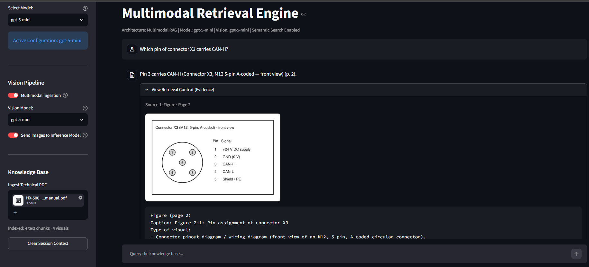
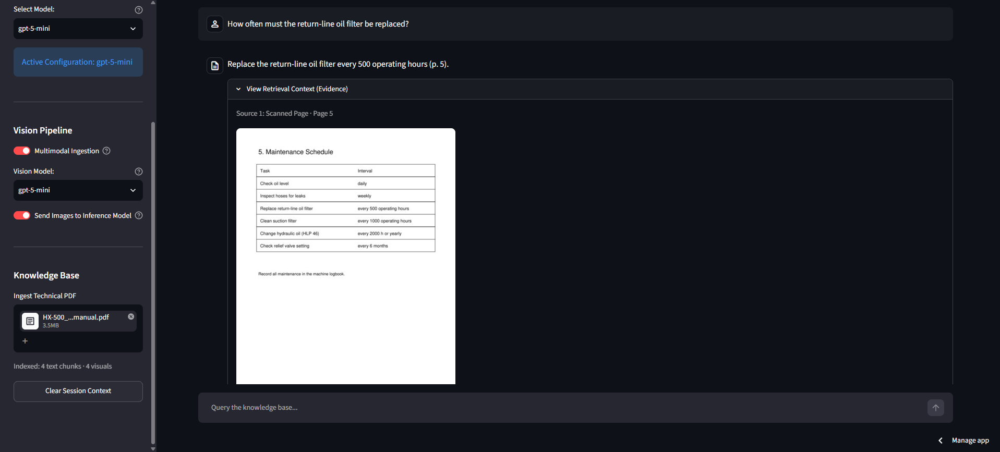

# AI-Powered Multimodal Technical Documentation Assistant

An intelligent question-answering system that helps engineers and technicians extract information from technical manuals — **including the information hidden in images, diagrams and scanned pages**. Ask questions in natural language and get accurate answers with page citations in seconds.

[](https://multimodal-docs-assistant.streamlit.app/)

[](https://www.python.org/)
[](https://github.com/langchain-ai/langchain)
[](https://platform.openai.com/)
[](https://www.trychroma.com/)
[](https://pymupdf.readthedocs.io/)
[](https://streamlit.io/)
[](tests/)
[](LICENSE)

---

## The Problem

Engineers working with technical documentation face a common challenge:
- **Manual search is slow**: Finding one value in a 500-page manual takes hours
- **Keywords fail**: Ctrl+F can't understand context or related concepts
- **The answer is often a picture**: Wiring diagrams, exploded views, schematics, spec tables and scanned legacy pages are **invisible to text-only search and text-only AI assistants**

A question like *"Which connector pin carries CAN-H?"* fails when the answer only exists in a diagram.

**This system solves that** by reading both the text *and* the visuals of a manual and answering from whichever contains the information, with the source shown.

---

## What This Does

Upload any technical PDF (user manuals, engineering specifications, maintenance guides, datasheets) and the system:

1. **Splits the text** into overlapping, searchable chunks
2. **Finds every visual**: embedded images, vector diagrams and scanned pages, and detects their captions
3. **Reads the visuals** with a GPT-5 vision model and turns each one into a searchable description
4. **Understands your question** using semantic (meaning-based) search across text *and* visuals
5. **Generates a grounded answer** with page citations, re-attaching the original images when a figure is relevant
6. **Shows the evidence**: the retrieved text chunks and the actual images

**Example Questions:**
- "What are the torque specifications for the front axle assembly?"
- "Which pin on connector X3 carries the CAN-H signal?"
- "What does the exploded view on page 12 show between the housing and the seal?"
- "List the maintenance intervals from the scanned service table"

---

## Live Demo

**Try it now:** [https://multimodal-docs-assistant.streamlit.app/](https://multimodal-docs-assistant.streamlit.app/)

1. Upload a technical PDF with diagrams or images
2. Select your answer model and vision model
3. Ask questions in plain English
4. Open **View Retrieval Context** to see the text and images used

### Screenshots

**Answer read from a connector pinout image**



**Answer read from a scanned page with no text layer**



---

## How It Works (Multimodal RAG Architecture)

This system uses **Retrieval-Augmented Generation (RAG)** extended to images:
- **Retrieval**: Finds the most relevant text chunks *and* visuals for your question
- **Generation**: GPT-5 writes the answer using only the retrieved text and images

### Architecture Flow

```
                     ┌───────────────┐
                     │  Upload PDF   │
                     └───────┬───────┘
            ┌────────────────┴─────────────────┐
            ▼                                  ▼
 ┌─────────────────────┐          ┌──────────────────────────┐
 │ TEXT (PyPDFLoader)  │          │ VISUALS (PyMuPDF)        │
 │ 1,000-char chunks   │          │ • embedded images        │
 │ 250 overlap         │          │ • vector diagrams        │
 └──────────┬──────────┘          │ • scanned pages          │
            │                     │ • captions detected      │
            │                     └────────────┬─────────────┘
            │                                  ▼
            │                     ┌──────────────────────────┐
            │                     │ GPT-5 Vision writes a    │  ← Cached by
            │                     │ searchable description   │    image hash
            │                     └────────────┬─────────────┘
            └────────────────┬─────────────────┘
                             ▼
              ┌──────────────────────────────┐
              │ One vector index (ChromaDB)  │  ← Text + visuals together
              └──────────────┬───────────────┘
                             ▼
              ┌──────────────────────────────┐
              │ User asks question           │
              └──────────────┬───────────────┘
                             ▼
              ┌──────────────────────────────┐
              │ Top-4 semantic search        │  ← Text and visuals compete
              └──────────────┬───────────────┘
                             ▼
              ┌──────────────────────────────┐
              │ GPT-5 answers with page refs │  ← Original images attached
              └──────────────────────────────┘
```

**Why RAG instead of asking GPT-5 directly?**
- **Accurate**: Answers are grounded in your specific document
- **Up-to-date**: Works with proprietary documents the model has never seen
- **Verifiable**: Every answer cites pages and shows its sources
- **Honest**: If the document doesn't contain the answer, the assistant says so

---

## Tech Stack

| Component | Technology | Purpose |
|-----------|-----------|---------|
| **LLM** | OpenAI GPT-5 (Nano/Mini/5/5.1) | Answer generation |
| **Vision** | OpenAI GPT-5 (image input) | Describes visuals at ingestion, verifies them at answer time |
| **Framework** | LangChain 0.2.16 | Loading, splitting, embeddings, vector store integration |
| **Vector Database** | ChromaDB | Semantic search over text chunks and visual descriptions |
| **Embeddings** | OpenAI text-embedding-3-small | Converts text and descriptions to vectors |
| **Text Extraction** | PyPDFLoader | Extracts page text |
| **Visual Extraction** | PyMuPDF | Extracts images, clusters and renders vector diagrams, renders scanned pages |
| **UI** | Streamlit | Interactive web interface |
| **Testing** | pytest + Streamlit AppTest | Offline tests with mocked OpenAI |
| **Deployment** | Streamlit Community Cloud | Free cloud hosting |

---

## Key Features

### 1. Multimodal PDF Understanding
Three kinds of visual content are captured:

| Visual Type | Example | How It Is Captured |
|-------------|---------|--------------------|
| **Embedded images** | Photos, screenshots, pasted diagrams | Extracted directly from the PDF |
| **Vector diagrams** | CAD exports, schematics, flowcharts, ruled tables | Drawing paths are clustered into regions and rendered to PNG |
| **Scanned pages** | Legacy manuals without a text layer | Whole page rendered and read by the vision model |

Noise is filtered automatically: logos repeated on 3+ pages, icons under 100 px, page borders, separator lines and duplicate images.

### 2. Semantic Search
Understands meaning, not just keywords:
- Query: "How do I fix overheating?"
- Finds: "thermal management", "cooling procedures", a cooling circuit diagram

### 3. Multi-Model Support
- **GPT-5-Nano**: Fastest, cheapest
- **GPT-5-Mini**: Balanced speed and accuracy (default)
- **GPT-5**: High-quality answers
- **GPT-5.1**: Complex reasoning and multi-step questions

The vision model is selected separately, so you can index with a cheap model and answer with a strong one.

### 4. Citation & Evidence System
- Every fact is cited with its page number
- The evidence panel shows retrieved text chunks **and the original images**
- Evidence stays attached to each answer in the chat history

### 5. Cost Control
- Vision descriptions are **cached by image hash**: re-uploading a document costs no extra vision calls
- Max 60 visuals per document, 4 parallel vision calls
- Multimodal processing can be switched off entirely (text-only mode)

### 6. Session Management
- Conversation history within a session
- Automatic re-indexing when the file content or vision settings change
- One-click session reset

---

## Installation & Local Setup

### Prerequisites
- Python 3.11 or higher (tested with 3.12)
- OpenAI API key ([Get one here](https://platform.openai.com/api-keys))

### Step 1: Clone Repository
```bash
git clone https://github.com/YasinVersiani/ai-powered-multimodal-technical-documentation-assistant.git
cd ai-powered-multimodal-technical-documentation-assistant
```

### Step 2: Create Virtual Environment
```bash
# Windows
python -m venv venv
venv\Scripts\activate

# macOS/Linux
python3 -m venv venv
source venv/bin/activate
```

### Step 3: Install Dependencies
```bash
pip install -r requirements.txt
```

### Step 4: Configure API Key
Create a `.env` file in the project root:
```bash
OPENAI_API_KEY=sk-your-api-key-here
```

### Step 5: Run Application
```bash
streamlit run app.py
```
Open your browser at `http://localhost:8501`

### Step 6: Run Tests (optional)
```bash
pytest -q
```
The tests mock OpenAI, so they run offline and for free. They generate a 4-page test manual (photo, vector schematic, scanned page, repeated logo) and verify extraction, caption detection, caching, indexing, image attachment and app start-up.

---

## System Parameters

| Parameter | Value | Why |
|-----------|-------|-----|
| **Chunk size** | 1,000 characters | Balance between context and retrieval precision |
| **Chunk overlap** | 250 characters | Prevents information loss at chunk boundaries |
| **Retrieval** | Top-4 sources | Enough context without wasting tokens |
| **Render resolution** | 150 DPI | Readable labels at reasonable image size |
| **Visuals per document** | Max 60 | Cost guard for very image-heavy manuals |
| **Images per answer** | Max 3 | Keeps answer requests fast and affordable |
| **Max file size** | 200 MB | Streamlit upload limit |

---

## Project Structure

```
ai-powered-multimodal-technical-documentation-assistant/
├── app.py                 # Main Streamlit application
│   ├── Visual Extraction Engine (images, vector diagrams, scanned pages)
│   ├── Vision Engine (descriptions + cache)
│   ├── RAG Pipeline (indexing, retrieval, answer generation)
│   ├── Sidebar Controls & Main Dashboard
│   ├── ETL Pipeline (document ingestion)
│   └── Inference Engine (chat + evidence display)
├── docs/                  # Demo screenshots
├── tests/
│   ├── conftest.py        # OpenAI mocks + generated sample PDF
│   └── test_app.py        # Pipeline and UI tests
├── requirements.txt       # Python dependencies
├── .env                   # API key (not in repo)
├── .gitignore             # Excludes secrets, temp files, extracted images, cache
├── LICENSE                # MIT
└── README.md              # This file
```

---

## Technical Implementation Details

### Visual Extraction
```python
# Embedded images (logos repeated on many pages and tiny icons are skipped)
pix = pymupdf.Pixmap(pdf, xref)

# Vector diagrams: cluster drawing paths into regions, then render each region
for rect in page.cluster_drawings():
    page.get_pixmap(dpi=150, clip=rect)

# Scanned pages: no text layer -> render the whole page
if len(page.get_text().strip()) < 50:
    page.get_pixmap(dpi=150)
```

### Visual Documents
```python
# The vision description is embedded; the image path travels in metadata
Document(
    page_content="Diagram (page 2)\nCaption: Figure 2-1 ...\n<vision description>",
    metadata={"type": "visual", "page": 1, "image_path": "./extracted_images/p2_vector_....png"}
)
```

### Multimodal Answer Generation
```python
docs = vector_db.similarity_search(question, k=4)
messages = [
    SystemMessage(content=SYSTEM_PROMPT.format(context=retrieved_text)),
    HumanMessage(content=[question, *original_images_of_retrieved_visuals]),
]
answer = ChatOpenAI(model=model_choice).invoke(messages)
```

### Custom System Prompt
The AI acts as a **"Technical Solutions Architect"** that:
- Maintains a professional engineering tone
- Keeps values, units and part numbers exactly as written
- Uses attached images to verify details
- Cites the page for every fact
- Says when information is missing from the document

---

## Design Decisions

- **Describe images instead of embedding them directly.** Image embeddings (e.g. CLIP) are trained on natural photos and perform poorly on technical drawings full of labels and numbers. A text description keeps a single embedding space and makes every label and part number searchable.
- **Re-attach the original image at answer time.** A description can miss a detail; the real image lets the model verify the exact value or connection.
- **Render vector graphics.** Many engineering drawings are vector paths, not images, so plain image extraction misses them completely.
- **Cache by content hash.** The same figure is never paid for twice, even across document versions.

### Known Limitations
- Visuals are sent to the OpenAI API. Don't use it on confidential documents without approval, or switch multimodal mode off.
- A diagram filling an entire page inside a page frame is filtered out together with the frame.
- Multi-part figures may be split into several regions.
- Very small or low-resolution text in images can still be misread.

---

## Deployment on Streamlit Cloud

1. Push the code to GitHub
2. Create a new app on [share.streamlit.io](https://share.streamlit.io) pointing to `app.py`
3. Add `OPENAI_API_KEY = "sk-..."` under **Settings → Secrets**
4. Auto-deploys on every push to `main`

**Deployment URL:** [https://multimodal-docs-assistant.streamlit.app/](https://multimodal-docs-assistant.streamlit.app/)

---

## Use Cases

### Manufacturing
- Read wiring and pneumatic diagrams in machine documentation
- Extract safety protocols and maintenance schedules
- Query scanned legacy manuals of older equipment

### Automotive
- Find connector pinouts and calibration procedures in ADAS documentation
- Retrieve diagnostic trouble code (DTC) explanations
- Understand exploded views in repair instructions

### Aerospace
- Query flight manual procedures and checklists
- Extract specifications from engineering drawings
- Find compliance requirements in regulatory documents

### General Engineering
- Read block diagrams and flowcharts in system specifications
- Extract values from charts and tables in datasheets
- Find test procedures in validation protocols

---

## Future Enhancements

- [x] **Multimodal PDF understanding**: Images, vector diagrams and scanned pages
- [x] **Page citations & image evidence**
- [ ] **Multimodal evaluation set**: Figure-only questions to measure retrieval hit rate (text-only vs. multimodal)
- [ ] **Structured table extraction**: Tables as rows/Markdown
- [ ] **Multi-document knowledge base**: Query across several manuals with filters
- [ ] **Page-image retrieval**: Compare against ColPali-style retrieval
- [ ] **Self-hosted vision model**: For confidential documents
- [ ] **Conversation export**: Download Q&A history as a PDF report

---

## Contributing

Contributions are welcome! Areas for improvement:
- Additional file formats (DOCX, HTML, Markdown)
- Better handling of multi-part figures
- Performance optimization for very large documents
- Multi-language support

---

## License

MIT License, see [LICENSE](LICENSE) for details.

---

## Author

**Yasin Versiani**  
Student, Technische Hochschule Deggendorf

[](https://github.com/YasinVersiani)
[](https://www.linkedin.com/in/yasin-versiani-6b6102320/)

---

## Acknowledgments

- **LangChain** for the RAG framework
- **OpenAI** for the GPT-5 API, vision and embeddings
- **PyMuPDF** for PDF image extraction and rendering
- **Streamlit** for rapid prototyping and free hosting
- **ChromaDB** for efficient vector storage

---

